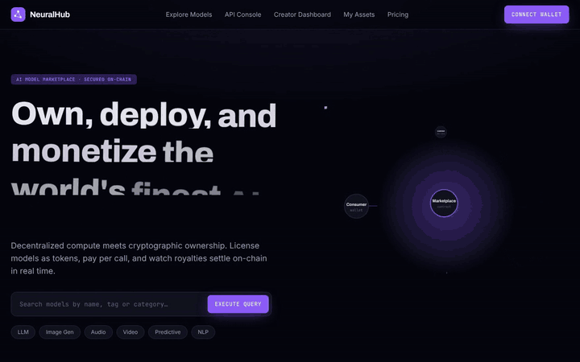
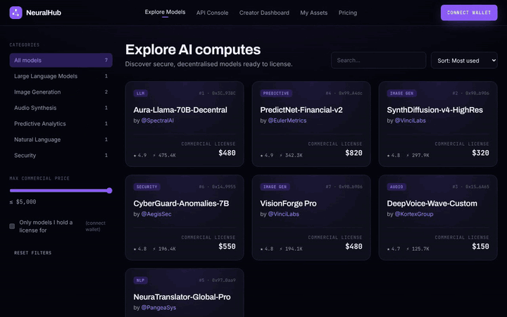
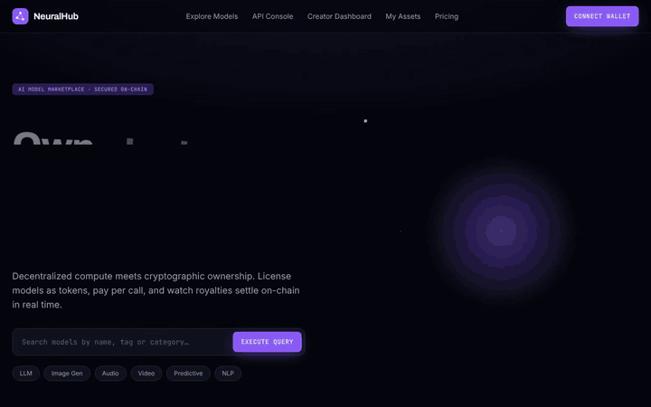
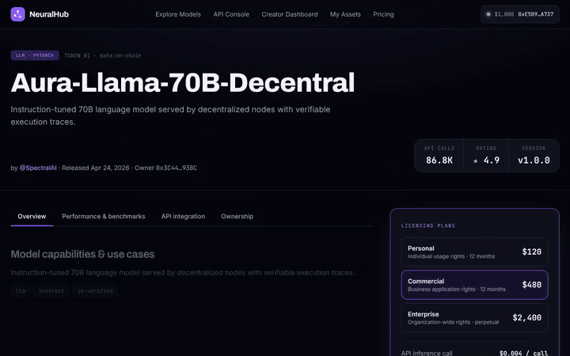
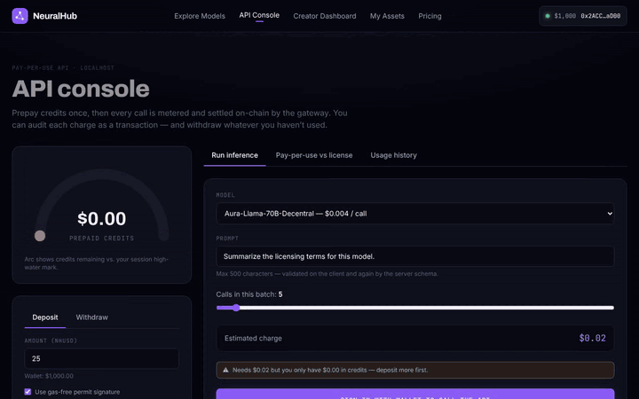
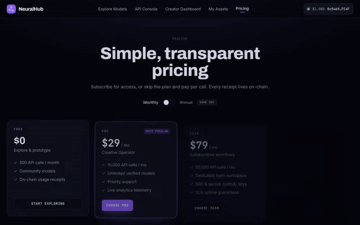
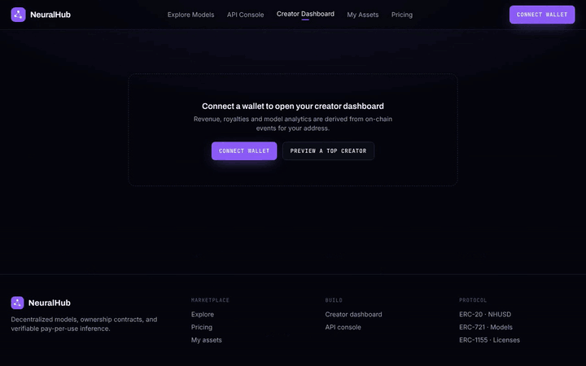

# NeuralHub — decentralized AI model marketplace

<p align="center">
  
</p>

<p align="center">
  <b>Models are ERC-721 tokens · licenses are ERC-1155 tokens · payments are ERC-20 with EIP-2612 permit · API usage is metered and settled on-chain.</b>
</p>

A working, end-to-end implementation of the frontend surface of an AI-model marketplace, built from the product docs for the "AI Model Marketplace" (SRS + design). Every flow below is real code running against a local EVM chain. The GIFs are recordings of the actual app, not mock-ups.

> **Scope honesty** — see [What is and isn't real](#what-is-and-isnt-real). Short version: everything EVM is real and tested against a local chain; Solana is wallet login + balance only; the card flow is a simulated processor; WalletConnect needs a project id.

```
contracts/   Solidity 0.8.28 + OpenZeppelin v5, Hardhat, 23 tests, deploy + 6-month seed script
web/         Next.js 15 (App Router) · React 19 · TypeScript · Tailwind v4 · wagmi 2 / viem 2 · GSAP
```

**Jump to:** [Explore](#1-discover-models-straight-from-the-chain) · [Wallet](#2-connect-sign-in-and-hold-assets-safely) · [Buy a license](#3-buy-an-erc-1155-license-with-one-signature) · [API console](#4-pay-per-use-api-with-on-chain-metering) · [Plans](#5-subscriptions-as-expiring-erc-1155-passes) · [Creators](#6-creator-royalty-dashboard) · [Run it](#run-it-2-minutes) · [Architecture](#what-each-job-requirement-maps-to)

---

## See it work

> **About these recordings.** They are captured headlessly by `pnpm demo:record` against a local Hardhat chain with the 7 seeded models. The "wallet" is the scripted EIP-1193 / EIP-6963 wallet the e2e suite uses, signing with a real key, so permits, transactions and sign-in take exactly the code path MetaMask would. Amounts are test NHUSD. The white dot is a cursor overlay added for the recording. See [Re-record the GIFs](#re-record-the-gifs).

### 1. Discover models straight from the chain



- Category filters, live search and sorting; cards re-flow with a **GSAP Flip** animation instead of jumping.
- The model page shows overview, benchmarks, API integration snippets and **ownership history**, all read from the contracts.
- **Under the hood:** the typed read layer batches JSON-RPC calls; metadata is resolved from `ipfs://`, `ar://`, `https` or `data:` URIs with ordered gateway fallback and zod validation (`lib/web3/ipfs.ts`).

### 2. Connect, sign in, and hold assets safely



- **EIP-6963 wallet discovery** lists detected wallets by name next to MetaMask, WalletConnect and **Phantom (Solana)** entries.
- Step 2 is a **free sign-in message** (SIWE with domain binding and a single-use nonce) that unlocks authenticated features. No gas, no funds can move.
- *My assets* covers all three token standards. Here: the ERC-20 faucet, then a transfer to a burn address that is **flagged before anything is signed** (`lib/web3/risk.ts`), then the ERC-721 and ERC-1155 tabs.

### 3. Buy an ERC-1155 license with one signature



- Pick a **Personal / Commercial / Enterprise** tier, then check out by card (simulated processor), see the **royalty split** (60 % model owner · 30 % compute partner · 10 % treasury), or pay with NHUSD.
- Approval hygiene is built into the UI: an **EIP-2612 permit** is the default (one transaction, no standing allowance), *exact approve* is second, *unlimited* is flagged.
- The transaction stepper shows *Sign permit (gas-free) → Purchase license → Confirmed on-chain*. The license then appears in the ERC-1155 tab with its **on-chain expiry**.
- **Under the hood:** every write is simulated first, so a revert shows a decoded human message before the wallet opens and costs no gas.

### 4. Pay-per-use API with on-chain metering



- Deposit prepaid credits with a **gas-free permit**, sign in, and run a batch of calls. The gauge burns down as the **gateway records usage on-chain**, and the live-events panel streams the contract logs.
- Each call returns a **receipt** with the settlement transaction. *Usage history* is rebuilt purely from logs.
- The **break-even calculator** compares pay-per-use, a commercial license and the Pro plan for a given call volume.
- **Under the hood:** only the server-side gateway key (`GATEWAY_ROLE`) can call `recordUsage`, so users can't self-report usage. Out-of-credit requests return `402`, per-wallet limits return `429`, and batches are idempotent.

### 5. Subscriptions as expiring ERC-1155 passes



- Monthly/annual toggle: the **20 % annual discount is computed by the contract**, not the UI (Pro $29 → $23 / mo, $278.40 billed yearly).
- Subscribing mints a **plan pass** (model id 0) whose expiry lives on-chain, so any app can verify the plan without asking the platform. It shows up under *My assets → Plan pass*.

### 6. Creator royalty dashboard



- Every number is **rebuilt from contract events**: no private analytics database. Monthly earnings, revenue by model, a 24-week inference heatmap, and a pull-payment **claim** balance.
- **Revenue split** editor (partner share ≤ 50 %, enforced by the contract) and a **Mint & list** wizard for publishing a model.
- Charts draw in with GSAP on scroll and honour `prefers-reduced-motion`.
- No wallet needed to look: *Preview a top creator* renders real analytics read-only.

---

## Run it (2 minutes)

```bash
pnpm install
pnpm chain            # terminal 1 — local Hardhat node (chain id 31337)
pnpm deploy:local     # terminal 2 — deploys 4 contracts, seeds 7 models + 6 months of purchases/usage
pnpm dev              # terminal 2 — http://localhost:3000
```

1. Add the network to MetaMask/Rabby: RPC `http://127.0.0.1:8545`, chain id `31337`.
2. Connect → **My assets → Claim 1,000 NHUSD** (faucet), or fund any address with gas + NHUSD: `TO=0xYourAddress pnpm fund`.
3. Try the flows shown above. No wallet? **Creator dashboard → "Preview a top creator"** renders real analytics read-only.

Production run needs a real `SESSION_SECRET` (the server **refuses** the placeholder — fail closed):

```bash
cp web/.env.example web/.env.local     # then set SESSION_SECRET, optional NEXT_PUBLIC_WC_PROJECT_ID, PINATA_JWT
pnpm build && SESSION_SECRET=$(openssl rand -hex 32) pnpm --filter @neuralhub/web start
```

CI (`.github/workflows/ci.yml`) runs typecheck, lint, contract + unit tests and a production build on every push, then boots a Hardhat node, deploys, starts the app and runs the Playwright suite.

Tests: `pnpm test:contracts` (23) · `pnpm --filter @neuralhub/web test` (37 unit) · `pnpm test:e2e` (5 browser tests against the real local chain; needs the chain, deployment and app running; set `CHROMIUM_PATH` to use a preinstalled Chromium) · `pnpm typecheck` · `pnpm lint`.

## Re-record the GIFs

The recordings in `docs/media/` are produced by code (`web/demo/record.spec.ts`, one test per scene), so they can be regenerated whenever the UI changes. With the local chain, the deployment and a production build running (exactly like the CI e2e job, including its `SESSION_SECRET`, `GATEWAY_PRIVATE_KEY` and `NEXT_PUBLIC_*` env vars):

```bash
pnpm demo:record   # 7 scenes → docs/media/raw/*.webm (git-ignored); fresh funded wallet per scene
pnpm demo:gifs     # ffmpeg → docs/media/*.gif  (720 px, 10 fps, 1.3×; runs gifsicle too if installed)
```

Needs `ffmpeg` on the PATH for the conversion and Playwright's Chromium and ffmpeg for recording (`pnpm --filter @neuralhub/web exec playwright install chromium ffmpeg`; set `CHROMIUM_PATH` to reuse a preinstalled Chromium).

## What each job requirement maps to

| Requirement | Where it lives | What to look at |
|---|---|---|
| **ERC-20 / 721 / 1155 UI interactions** | `features/assets`, `features/models`, `features/checkout` | *My assets*: faucet, transfer, approve/revoke (ERC-20); owned models + transfer (ERC-721, ERC-2981 royalty shown); license holdings with on-chain expiry, transfer, `setApprovalForAll` (ERC-1155) |
| **Wallet flows: MetaMask, Phantom, WalletConnect** | `lib/web3/config.ts`, `components/wallet`, `lib/solana/phantom.ts`, `features/auth` | EIP-6963 discovery (MetaMask, Rabby, Phantom-EVM… appear by name), WalletConnect connector (QR/mobile), Phantom **Solana** via `window.phantom.solana` (no heavy SDK), SIWE/SIWS sign-in, wrong-network + disconnect handling |
| **Upgradeable frontend patterns** | `lib/web3/contracts.ts`, `lib/web3/deployments.ts`, `lib/web3/indexer.ts` | Versioned contract registry — a v2 ABI is added under a new key and only changed call sites adapt; chain config is data, not code; `Indexer` interface lets `RpcIndexer` be swapped for The Graph/Ponder with no component changes |
| **Maintainable state management** | `lib/store`, `hooks/useChainQuery.ts`, `hooks/useAppChain.ts` | Strict split: **zustand = UI-only state**, **TanStack Query = all chain/server state** with keys namespaced `["nh", chainId, …]`, so one invalidation after any transaction refreshes everything. `useAppChain` is the single source of truth for the active chain |
| **On-chain event listeners & indexing** | `hooks/useLiveEvents.ts`, `lib/web3/indexer.ts` | Live feed (console) from `watchContractEvent`; dashboard charts and usage history rebuilt purely from logs (chunked `getLogs`, block-timestamp cache, pure bucketing helpers with unit tests) |
| **Multi-chain** | `lib/web3/chains.ts`, `deployments/all.json`, `NetworkBanner` | Local, Base Sepolia, Sepolia, Polygon Amoy (+ mainnets) via env; per-chain deployment registry; network switcher; "not deployed here" is a handled state |
| **IPFS / Arweave display** | `lib/web3/ipfs.ts` | `ipfs://`, `ar://`, `https`, `data:` resolver with ordered gateway fallback + timeouts, zod-validated metadata, image-URL allow-listing; pin route uses Pinata if configured |
| **Checkout: card, crypto, stablecoin** | `features/checkout/CheckoutModal.tsx` | Tabs for card (simulated processor, Luhn + zod), Web3 crypto/stablecoin (permit / exact approve / unlimited with risk flags) and royalty-split preview |
| **Royalty dashboards** | `features/dashboard` | Earnings by month, per-model donut, 24-week activity heatmap, per-model sparklines, pull-payment **claim**, revenue-split editor (partner ≤ 50% enforced by the contract) |
| **Pay-per-use pricing UI with on-chain usage tracking** | `features/console`, `app/api/gateway/infer` | Prepaid credits (permit deposit / withdraw), metered inference through a gateway that holds `GATEWAY_ROLE` and records usage on-chain, burn-down gauge, receipts per call, break-even calculator (pay-per-use vs license vs plan) |
| **Subscription / enterprise UI** | `features/pricing` | Monthly/annual toggle (annual discount computed by the contract), Pro/Team plan passes minted as ERC-1155, feature matrix, FAQ, Enterprise path |
| **Frontend security** | see next section | Reentrancy-aware UI, input validation, access indicators, gas awareness, client-side protections |
| **Performance** | `lib/web3/read.ts`, `Providers.tsx` | JSON-RPC batching, cookie-hydrated wagmi state (no wallet flash on reload), metadata cached forever by URI, code-split routes (≈ 105 kB shared JS) |
| **Motion (GSAP)** | `lib/motion/gsap.ts`, `components/motion`, `components/charts`, `TxStepper` | See [Motion](#motion) |

## Security & correctness choices

- **Reentrancy-aware UI.** `useTxFlow` holds a double-submit lock, so a fast double-click can't send two transactions; contracts additionally use `ReentrancyGuard` and pull payments.
- **Simulate before sign.** Every write is `simulateContract`-ed first, so a revert shows a decoded, human message (custom errors mapped in `lib/web3/errors.ts`) *before* the wallet opens and costs no gas.
- **Approval hygiene.** Default is an **EIP-2612 permit** (one tx, no standing allowance). Exact approve is next; unlimited is flagged. `lib/web3/risk.ts` is a pure, tested function that flags unlimited approvals, unknown spenders, burn/deny-listed recipients, self-transfers, and `setApprovalForAll` to unknown operators.
- **Money is never a float.** `parseAmount` parses decimal strings straight to base units with `parseUnits`, rejects over-precision, and caps at balance.
- **Wallet login done properly.** SIWE/SIWS message with domain binding (anti-phishing), **single-use nonce** (burned on read), freshness window, EVM `verifyMessage` / Ed25519 verification, httpOnly+SameSite JWT cookie. Rate-limited.
- **Users can't self-report usage.** Only the server-side gateway key (`GATEWAY_ROLE`) can call `recordUsage`; batches are idempotent by id; insufficient credits return **402**; per-wallet rate limit returns **429**; the nonce queue serializes gateway transactions.
- **Untrusted content.** Token metadata is zod-validated; `javascript:`/`file:`/remote-http URIs are rejected; only image-typed `data:` URIs render.
- **Headers.** `nosniff`, `X-Frame-Options: DENY` (signing UIs must not be framed), strict referrer policy, restrictive permissions policy.
- **Fail closed.** Production refuses to start sessions with a placeholder secret; every API route returns JSON errors (`lib/server/http.ts`).

## Motion

GSAP 3.15 with its free plugins (ScrollTrigger, Flip, SplitText, DrawSVG, MotionPath), all through one wrapper:

- **Hero value-loop graphic** (`HeroNetwork`): wires drawn with DrawSVG, packets travelling along them with MotionPath on a looping master timeline, node pops and ring pulses.
- **SplitText headline**, scroll-triggered **Reveal** (handles children that arrive later from async chain data), **Flip**-animated explore filtering/sorting, sliding tab underline, magnetic buttons, count-up numbers.
- **Transaction stepper**: rail fill, DrawSVG tick on success, shake on failure.
- **Charts** draw in on scroll: line/area, donut, 24-week heatmap, sparkline, credit gauge that tweens as usage burns credits.
- **Accessible by default:** everything goes through `motion()` (`gsap.matchMedia`), so `prefers-reduced-motion` gets the final state with no animation; a no-flash CSS pre-hide plus a 5-second failsafe class means content can never stay invisible if JS or GSAP fails.

## Contracts (`contracts/`)

| Contract | Standard | Role |
|---|---|---|
| `NHUSD` | ERC-20 + EIP-2612 | 6-decimals stablecoin with a rate-limited faucet (test only) |
| `ModelNFT` | ERC-721 Enumerable + URIStorage + ERC-2981 | Model identity. **The current owner receives the creator revenue share** |
| `ModelLicenses` | ERC-1155 + AccessControl | id = `(modelId << 8) \| tier`; on-chain expiry travels with the token; one per holder; `modelId 0` = platform plan passes |
| `Marketplace` | — | Pull-payment balances, prepaid credits escrow, permit-based buy/subscribe/deposit (front-run-safe permit), usage metering, 10% platform fee, partner split ≤ 50% |

## What is and isn't real

| | Status |
|---|---|
| EVM contracts, wallet flows, permit, events, indexing, metering, gateway settlement | **Real.** Tested (23 contract tests, 5 browser e2e on a live local chain with a scripted EIP-1193/6963 wallet signing with a real key) |
| Solana | Phantom connect, **sign-in (Ed25519)** and balance. **No on-chain Solana settlement program** — payments are EVM |
| Card payments | **Simulated** processor (test mode, validation and error paths real). In production a PSP webhook would trigger a custodial mint |
| Model weights / inference | Weights are referenced by URI, not hosted; inference output is a mock. Metering and settlement around it are real |
| Metadata storage | Demo stores metadata as `data:` URIs. IPFS/Arweave resolution is implemented and unit-tested; set `PINATA_JWT` to pin real IPFS |
| WalletConnect | Implemented; shows once `NEXT_PUBLIC_WC_PROJECT_ID` is set |
| Upgradeability | Contracts are not proxied; the *frontend* is structured (versioned ABI registry) to survive redeploys and ABI changes |
| Testnets | Config and deploy script targets exist (Base Sepolia, Sepolia, Amoy via `DEPLOYER_KEY`); only the local chain was exercised in testing |
| Audits | None. Test-network software |

## Layout

```
web/src
  app/            routes (App Router) + API routes (auth, gateway, pin, card, licenses)
  features/       landing · explore · models · checkout · assets · pricing · console · dashboard · auth · tx · account
  components/     ui · motion · charts · nft · wallet · tx · layout
  lib/web3/       chains · config · contracts (versioned) · deployments · ipfs · indexer · read · errors · risk · format
  lib/server/     session (SIWE/JWT) · gateway (usage settlement) · rateLimit · http
  lib/store/      zustand UI state          lib/motion/gsap.ts   plugin registration + reduced-motion wrapper
  __tests__/      unit tests (37)           e2e/                 Playwright + mock wallet
```
